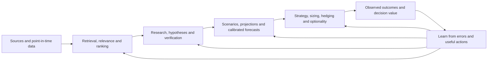

# Spectral Nature prediction-machine improvement scope

Owner clarification: **2026-10-16**. [Research index](../README.md) · [Current gaps](../../plans/OCTOBER_APPLIED_RESEARCH_FALL_2026_MASTER_PLAN.md) · [Cheap open-source candidates](OPEN_MODEL_CANDIDATES_2026-10-16.md) · [Research TODOs 2–6](README.md)

## Objective and constraints

Improve the complete prediction and decision system around **cheap open-source LLMs**. The optimization target spans acquisition, information retrieval, relevance, ranking, research strategy, memory, projections, forecasts and decisions. Stronger closed models are external comparators, not a proposed dependency or fallback.

Use models through replaceable inference transports and the shared AQL/Zopedia engine. Apply the constraint to runtime, graders, optimization teachers and research experiments. Keep the LLM backbone frozen in the primary system comparisons; cheap eligible replacements have a separate shortlist. Statistical/ML forecasting, ranking and calibration models are part of the surrounding system and remain improvement targets.

Preserve the existing candidate counts, depth, schedules, output limits and configurable review settings for the first comparisons. The **+20% overall workload cost allowance** remains in force. Research/optimization costs are separately recorded and amortized, not hidden as free infrastructure.

## The full flow

This is a map of responsibilities, not a requirement for a new model call or agent at every box. Research also serves explanations and discovery without requiring a portfolio action. Forecasts and decisions are distinct artifacts: a good probability estimate can support different actions under different costs, positions and objectives.

## Improvement workstreams

These are proposed comparisons and audit targets. The broader system has not yet received a complete current SOTA audit; distinguish verified existing mechanisms from missing evidence.

| Workstream | What to improve outside the LLM | Evidence of improvement |
| --- | --- | --- |
| **Data and information retrieval** | Point-in-time coverage, source versions, filing/transcript tables, search-query choice, hybrid retrieval, complementary passages, contradictions and access to originals. Reuse evidence across questions without losing dates or source meaning. | Independently reviewed aspect coverage and retrieval recall; correct downstream derivations; source availability; cost of useful evidence. |
| **Ranking, sorting and relevance** | Which subjects and sources deserve attention, in what order, and for which horizon. Learn relevance/research value from outcomes and reviewed preferences while preserving exploration and indirect connections. | Ranking usefulness at unchanged capacity; missed valuable candidates, verified discovery yield/lead time, downstream forecast improvement and exposure bias. |
| **Research loops and strategizing** | Investigation plans, question decomposition, competing hypotheses, counterevidence, tool choice, when to continue and when to stop. Let new evidence redirect the investigation. | Same-checkpoint branch comparisons: useful conclusions and forecast/decision gains per unit of total computation and evidence acquisition. |
| **Learning from failures** | Turn graded trajectories, failed checks, useful recoveries and successful controls into better shared instructions, retrieved examples or learned guidance. Track whether the same error family recurs. | Held-out improvements across unfamiliar cases; retained strengths; effect on complete workflow cost. A longer warning prompt is not the objective. |
| **Model allocation** | Select among eligible cheap models and effort levels by responsibility and learned outcomes. Reuse paid work and allocate extra computation where it improves the result. | Complete quality/cost/completion trade-offs against the same-model baseline, including allocation overhead and induced corrections. |
| **Reasoning and correction** | Choosing and formulating calculations, checking definitions and feasibility, resolving conflicting sources, changing an anchored conclusion, and protecting correct drafts from harmful review. | Objective derivations plus independent qualitative assessment of pre/post answers, missed errors, false objections and timely useful correction. |
| **Projections and scenarios** | Explicit assumption-to-outcome models for business quantities and market scenarios: periods, units, reconciliations, dependencies, sensitivities, alternatives and plausible ranges. Use tools/statistical models for execution. | Source-faithful assumptions; numerical consistency; later realized quantities; scenario coverage and interval calibration. A scenario is not a calibrated forecast merely because it has numbers. |
| **Forecasting** | Probabilities and distributions by target/horizon, base rates, empirical and semantic signals, calibration, combining predictions, regime sensitivity and forecast revision. Compare simple statistical and learned baselines as well as LLM reasoning. | Time-based/prospective Brier/log scores for events, suitable distribution/interval scores for continuous targets, calibration and performance across regimes. |
| **Strategy and decision selection** | Translate forecasts into choices given current price, payoff, costs and existing exposures. Compare actions, horizons, invalidation and waiting for more information. | Incremental decision value under the same forecasts and information; executable net outcomes against declared simple policies. Research-call accuracy alone cannot establish a portfolio strategy. |
| **Bet sizing and portfolio construction** | Position sizes based on estimated payoff distributions, forecast uncertainty, dependence, concentration, liquidity, turnover and available capital. Compare learned/statistical allocation with simple baselines. | Net outcomes, drawdown/tail exposure, concentration, turnover and robustness to forecast/covariance error. Fluent confidence must not become a position size. |
| **Optionality and hedging** | Value of waiting, staged commitments, reserving capacity for later information, and payoff asymmetry. Where options contracts are studied, include actual quotes, expiry, volatility, spreads and executable multi-leg costs. | Compare immediate/staged/deferred choices and hedged/unhedged alternatives under the same information and capital assumptions. Keep realized option returns separate from unpriced theoretical payoffs. |
| **Memory and longitudinal learning** | Which discoveries, failed hypotheses and corrections should change later investigations and forecasts. Distinguish supported facts, dated beliefs and uncertain relationships. | Linked-session and later-period improvements over isolated research; stale-belief correction, source fidelity and value of shared evidence. |
| **Evaluation** | Independent objective, judgment and future-outcome labels; calibrated graders; frozen replay, chronological holdouts and a prospective cohort. Record complete attempts, failures and cost. | Reproducible comparisons that can attribute gains to each layer and reveal subgroup harms. Overall usefulness and decision quality stay visible alongside component metrics. |

## What existing source establishes

- The [all-signal ranker](../../architecture/market_data/TRADING_AGENT_ALL_SIGNAL_RANKER_2026-09-21.md) and [current source](../../../services/all_signal_ranker.py) use peer percentiles, family/domain balancing and rank fusion. That is a useful candidate-selection baseline, not a demonstrated outcome-trained research-value ranker.
- The [discovery redesign](../../architecture/overall/redesigns/DISCOVERY_MODEL_ARCHITECTURE_2026-10-07.json) proposes temporal/relationship representations and a later preference learner. It does not establish a trained learner's predictive benefit.
- [compute/signals.py](../../../compute/signals.py) contains an analogue/resampling forecast that emits paths, percentiles and event probabilities. This establishes an existing numerical baseline, not demonstrated out-of-sample calibration or SOTA forecasting.
- The inspected [Trading Agent prompt](../../../services/trading_agent.py) explicitly produces research packages rather than portfolio allocation/execution. The older [backtest assessment](../../plans/TRADING_AGENT_BACKTEST_ASSESSMENT_2026-07-03.md) distinguishes research-call outcomes from a portfolio policy. Those records do not establish that sizing, portfolio optimization or options decisions are already implemented and validated. Inventory the current owners/data before proposing changes.

## Experiment order

The [current gap and closure sequence](../../plans/OCTOBER_APPLIED_RESEARCH_FALL_2026_MASTER_PLAN.md#closure-sequence) specifies the candidate methods, evidence required to move forward and same-model harness comparison for these workstreams.

1. Establish current component owners, data contracts and reference outputs. Retain the accepted focus on learning from failures, model allocation, reasoning/correction and evaluation. Use the existing [ground-truth inventory](GROUND_TRUTH_2026-10-16.md).
2. Compare harness, retrieval and relevance changes while holding the cheap model and workload settings fixed. Measure research usefulness and future predictive benefit separately.
3. Compare scenario/forecast/calibration methods on strict historical and prospective inputs. Give every candidate the same information and forecast targets.
4. Hold forecasts fixed when comparing strategy, sizing and optionality. Then evaluate the combined system. This separates a good forecast from a good decision policy.
5. Compare eligible model alternatives separately; evaluate a combined change only after its components can be understood. Preserve simple baselines and price all work.

The [longitudinal research program](../TOP_TIER_RESEARCH_PROGRAM_2026-10-16.md) remains a future methods project. The present product objective is a better complete prediction machine under the cheap-open-model constraint. No model switch, paid evaluation, deployment or trading action is performed by this scope update.
