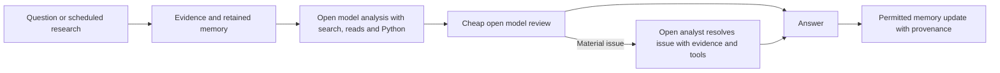

# Frontier research TODO: research quality, learning and cost

Date: **2026-10-16**. Status: **research agenda; experiments not run**.

[Research index](../README.md) · [Ground truth by failure mode](GROUND_TRUTH_2026-10-16.md) · [Literature survey](LITERATURE_SURVEY_2026-10-16.md) · [Active implementation plan](../../plans/ZOPEDIA_REASONING_QUALITY_COST_2026-10-15.md)

For the present-system comparison, read [Current gap to SOTA](../../plans/OCTOBER_APPLIED_RESEARCH_FALL_2026_MASTER_PLAN.md). This file records the future research program.

**Owner constraint, October 16:** use cheap open-source models throughout. Improve everything around them: [prediction-machine scope](PREDICTION_MACHINE_SCOPE_2026-10-16.md). [Eligible model candidates](OPEN_MODEL_CANDIDATES_2026-10-16.md) are marked for separate comparison; no proprietary-model escalation is proposed. Learning from failures, model allocation, reasoning/correction and evaluation remain accepted priorities.

## Research objective

Make Spectral Nature better at acquiring information, choosing useful investigations, deriving conclusions, producing calibrated forecasts and making decisions. Improve the harness, retrieval, relevance/ranking, research loops, memory, scenarios, strategy, sizing and optionality around cheap open-source models. Preserve useful hypotheses while correcting material errors.

Keep the intended flow simple:

The current configuration uses DeepSeek Pro/Flash; model names are replaceable implementations of these roles. Acquisition, relevance and first-pass summaries use cheap eligible models. The monitor guides the investigation with configurable freedom. Analysis can revisit originals and take useful tool actions. Review supplies evidence to assess; it does not automatically override the analyst. Preserve one configurable review cycle, independent reviewer-count controls, and the existing breadth, depth, schedule and output values. The diagram describes research responsibilities; the linked scope extends through forecasts and decisions.

The production cost constraint is **at most +20% across the same weighted workload**. Difficult runs can cost more. Count failed attempts, repairs, corrections, summaries and their construction, embeddings and other paid services. Keep unknown charges explicit. Research/optimization spend needs a separate budget and amortization estimate; it does not disappear from economics because it is offline.

## What the survey changes

There is no single demonstrated SOTA architecture for open-ended financial discovery. Current work supports expert-grounded evaluation of the derivation, selective use of tools and stronger reasoning, complementary evidence retrieval, and learning from complete execution traces. It also supplies counterexamples to assuming more review, deeper recursion or consensus always improves quality. See the [survey and dated benchmark comparisons](LITERATURE_SURVEY_2026-10-16.md).

Our design already has useful foundations: split responsibilities, a shared engine, original sources, hybrid retrieval, analytical tools, model settings and review continuation. Those similarities do **not** establish SOTA performance. Current failures show gaps in consequential calculations, source interpretation, review precision and correction completion. We have no matched external benchmark score or representative paired workload result, so a numerical distance from SOTA is unknown.

The first research investment should be trustworthy evaluation data and feedback, followed by a measured improvement to the existing loop. A new advisor, router, graph or agent hierarchy earns its place through incremental held-out benefit and complete cost.

## TODO 1 — Establish ground truth and isolate failures

- [ ] Turn the [failure inventory](GROUND_TRUTH_2026-10-16.md) into reviewed examples, retaining ordinary successes and the known sound-draft controls.
- [ ] Distinguish missing evidence, inaccessible evidence, wrong interpretation, wrong calculation setup, execution error, harmful review, correction failure and evaluator error. Several can occur in one trajectory.
- [ ] Label what is established now, what is only partially identified, and what needs future observations. Preserve multiple defensible analyses and useful tentative hypotheses.
- [ ] Audit historical source availability and label readiness before choosing temporal splits. Existing row counts support feasibility, not automatic acceptance of a backtest.

Completion evidence: an inspectable set of examples with original sources, derivations or independent adjudication, label provenance, uncertainty and split membership. The published October 15–16 cases are development examples, never a newly claimed blind test.

## TODOs 2–6 — Preserve the proposed ML/agent/harness program

These retain the five parts the owner accepted, with concrete next work.

### 2. Build a dataset of research decisions

- [ ] Use the existing engine, trace/receipt storage and historical corpus. Record question, as-of time, source/memory snapshot, effective settings, model/prompt/code identity, available actions, chosen action, tool arguments and results, draft, review, correction, final answer, latency and complete cost. Store visible actions and evidence; private model chain of thought is unnecessary.
- [ ] Keep two cohorts: a representative sample of ad hoc, queued research, Home, Trading and news/company work; and a diagnostic set of known failure families with unfamiliar instances. Report them separately.
- [ ] Separate development, selection and untouched evaluation by time and by related event/entity/source family where appropriate. Keep repetitions and variants of one example together.
- [ ] Annotate the consequential decision and available alternatives. Unchosen actions are unobserved, not negative training labels. Capture pre-review and post-review quality separately.
- [ ] Use humans and LLMs to propose semantic labels, then verify objective claims from sources/calculations. Retain disagreement and adjudicate a sample of agreements too.

Completion evidence: a versioned dataset manifest, coverage report and independently reviewed pilot; no preferred-answer string checks.

### 3. Make verification an analytical action

- [ ] Give the analyst the existing tools and let it decide whether a source read, calculation, comparison, sensitivity analysis or counterexample would change the conclusion.
- [ ] Compare normal analysis with the same case supplied independently verified computations. This separates choosing/formulating a check from executing and using it.
- [ ] Assess whether the analyst uses actual results, including units, dates, denominators, feasibility and alternative explanations. A successful Python process does not validate a wrong formulation.
- [ ] Evaluate review against both material-error examples and sound drafts. Measure errors corrected, errors missed, sound conclusions damaged, useful hypotheses lost, correction completion and additional cost.
- [ ] Preserve originals and useful paid work across continuation. Evaluate semantic evidence use separately from transport/persistence correctness.

Completion evidence: unfamiliar cases show more useful, correct analysis through the complete loop, including successful resolution of material feedback within the chosen budget. No case-specific rules or universal mandatory tool call.

### 4. Learn the value of additional computation

- [ ] Fork a sampled set of identical research checkpoints into controlled alternatives: continue as is, read an original, calculate, search, use stronger reasoning, or stop. Start with a small number of alternatives justified by the failure inventory.
- [ ] Measure paired quality change, completion, latency and full marginal cost. Repeat where variation could reverse the conclusion. The best sampled branch is an optimistic reference, not an achievable learned-policy score.
- [ ] First compare improved shared instructions and retrieved, validated examples inside existing calls. Then test learned request/step guidance against those baselines. Fine-tuning a small advisor or router is a later option if the clean data and serving volume justify it.
- [ ] Begin with supervised guidance or predictions of per-action quality gain, completion probability, cost and latency from the checkpoint. Select among measured trade-offs under the workload constraint. Consider contextual-bandit/RL updates only after reliable feedback and exploration coverage exist; an observed best branch is a noisy hindsight label, not certainty about the best action.
- [ ] Learn semantic allocation from outcomes, not a hand-written taxonomy of question keywords. Preserve freedom to ignore advice when evidence changes. Do not narrow discovery to directly named entities.
- [ ] Evaluate allocation on untouched workload data under the existing breadth/depth values. Report quality/cost trade-offs and important subgroup failures, not just average savings.

Completion evidence: the deployed-style policy captures held-out gains after counting its own calls, context overhead and induced downstream work; workload cost ratio stays at or below 1.20. No new routing model is approved by this TODO.

### 5. Calibrate an independent evaluator

- [ ] Build task-specific criteria from source evidence and the actual research objective before seeing candidate answers. Permit alternative correct derivations and newly supported insights.
- [ ] Give objective subclaims independent arithmetic, table, dated-source or environment-state checks. Calibrate judgment of interpretation and usefulness against blinded expert review.
- [ ] Hide model/configuration names, randomize pair order, and measure order/verbosity effects, missed material errors, false objections and severity. Judge consensus is a signal to audit, not ground truth by definition.
- [ ] Evaluate the evaluator on held-out labels, including easy-to-miss failures and correct controls. Report disagreement and uncertainty. Recalibrate after changing judge models or rubrics; do not mix leaderboard versions.
- [ ] Keep the production critic separate from acceptance judging. Personal inspection of complete answers and material disagreements remains part of the assessment.

Completion evidence: documented evaluator precision/recall and human agreement on each relevant failure family, with examples of remaining mistakes. Mechanical completion and critic approval are not substitutes.

### 6. Run controlled experiments and temporal backtests

- [ ] Freeze the baseline and candidate and run the same engine against isolated evidence/memory. For analysis-only comparisons hold evidence fixed; for full-agent comparisons allow alternative actions against the frozen corpus.
- [ ] Begin with ablations that resolve a question: raw versus supplied computed results; pre/post review; prompt improvement versus learned guidance; hybrid retrieval versus aspect-aware reranking; original context versus optional summaries.
- [ ] Hold workload knobs fixed in the first comparisons. Do not buy an apparent improvement by reducing candidates, search depth, output coverage or refresh frequency.
- [ ] Use paired reporting and uncertainty across independent cases/time blocks; account for repeated runs and selection among many candidates. Add a fresh final holdout after development, not repeated tuning on the current examples.
- [ ] For forecasts and Trading, use the [as-of temporal protocol](GROUND_TRUTH_2026-10-16.md#temporal-evaluation-and-future-ground-truth), outcome labels held outside the agent, proper probabilistic scores, simple baselines and executable net-return assumptions where relevant.
- [ ] Count all work using production frequencies: `sum(frequency × candidate cost) / sum(frequency × baseline cost) <= 1.20`. Preserve failure and incomplete-answer denominators. Do not average per-run percentage changes.

Completion evidence: a complete, personally inspected report of quality, failure severity, completion, latency and matched workload cost. Frozen backtests establish their scoped results; a later small integration check establishes provider/queue/storage behavior. A prospective cohort is needed for claims vulnerable to knowledge already in model weights.

## Highest-ROI research questions

These extend the parts already aligned with current practice. None assumes we have proved benchmark leadership.

| Priority | Research question | Smallest informative comparison and ground truth | Why it could pay off |
| --- | --- | --- | --- |
| First | Does the analyst fail to choose a calculation, formulate it, or use the result? | Same unfamiliar cases with normal tools, verified setup, and supplied computed results; source-backed mathematical assessment. | Directly addresses observed errors before spending on another agent. |
| First | When does cheap review improve the answer enough to justify premium correction? | Same correct/error drafts through review variants; blinded pre/post adjudication plus complete correction cost. | Harmful or immaterial edits already trigger paid timeouts. |
| First | Does reading an original actually change an anchored conclusion? | Same checkpoint with source available, actually read, or salient verified evidence supplied; assess the final reasoning. | Separates retrieval, exposure and belief revision. |
| Next | Can learned guidance beat an improved shared prompt within +20%? | No guidance versus retrieved examples versus request-specific guidance on a held-out workload. | Reuses current roles; tests a promising frontier idea without committing to a new serving stack. |
| Next | Can complementary evidence improve discovery without narrowing candidate recall? | Same candidate/depth limits, alternative ranking; independent aspect coverage and later verified discoveries. | Hybrid retrieval is legitimate, but similarity and fusion alone do not demonstrate investigation coverage. |
| Next | Which memory updates help a later investigation? | Replay linked sessions with isolated, versioned memories; measure future decision quality and source fidelity. | Tests useful learning rather than memory volume or one-shot recall. |
| Later | When do reusable summaries break even without losing decision-relevant relations? | Flat, existing summaries and adaptive original access across repeated tasks; derivation quality and total construction/retrieval cost. | Current prototype is off; neither its failures nor a published hierarchy settles our reuse economics. |
| Parallel | Does open-ended discovery improve forecasts or find useful leads earlier? | Predeclared future events/forecasts and dated discoveries versus matched baseline coverage; temporal/prospective outcomes. | Connects analytical usefulness to a measurable product objective without making every hypothesis a trade. |

## Immediate handoff

The next agent should start with ground-truth annotation and a small reviewed dataset, then evaluator calibration, then a controlled experiment addressing one of the first three questions. Save the dataset/protocol in this research topic and link resulting evidence from the index. Choose sample size and research spend from pilot variance, error prevalence and cost; the existing exploratory sample does not support a credible power estimate yet.

This document adds no runtime stage, changes no model/knob, runs no paid evaluation and authorizes no release. Implementation and deployment status remain in the linked active plan and release receipts.
