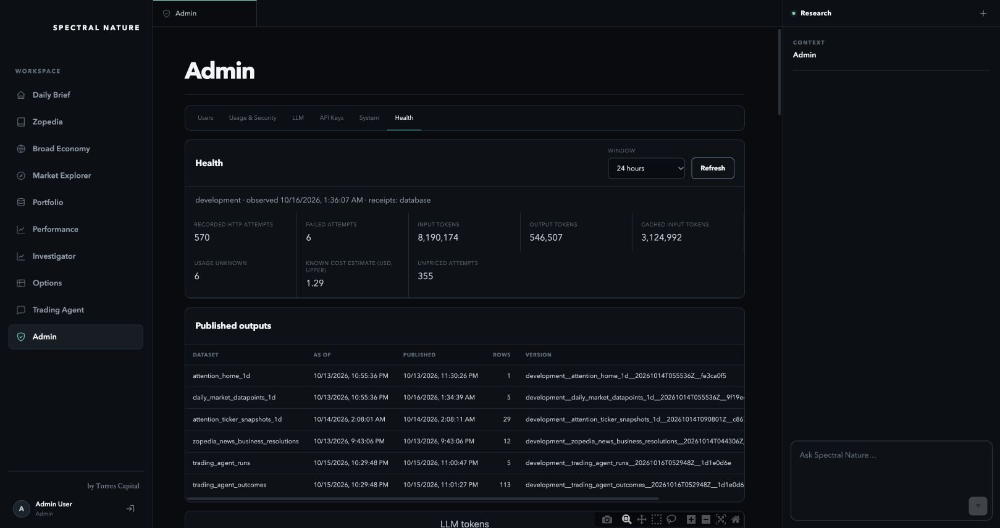

# Combined development reliability release — October 16, 2026

**Source-preservation acceptance superseded.** The [subsequent regression audit](../release-source-regressions-2026-10-16/README.md) found that the combined source replaced accepted consumer-specific behavior. The component checks below remain evidence of their stated scope; the claims that the complete accepted source union preserved application functionality are withdrawn. Do not use this receipt as blanket release acceptance.

Accepted operational repairs are deployed to all four development apps and eleven development job templates. The shared research engine revision is `7281e3631a1764cf48c9`. The unaccepted reasoning/cost flow and hierarchical summarization defaults are excluded. This release used complete accepted source snapshots and role-specific immutable images, preserving the separately accepted native/Trading work.

[Live Admin](https://sn-next-ui-dev.bluefield-2d27dcf2.centralus.azurecontainerapps.io/admin) → Health. [Immutable images, source hashes and validation receipts](release.json).

## What changed

- Shared transaction-owned PostgreSQL sessions return physical connections after commit/rollback, with a bounded two-connection null pool per process and exact credential identity. Explicit transactions, savepoints and session advisory locks retain their ownership. This is not a server-wide admission limit.
- Chart selection and learning critiques navigate invocation-owned catalogs and complete original records through shared tools. Original histories remain available. Media and old generated chart interpretations do not enter the new chart evidence context. Exact series statistics support numerical interpretation without prescribing the chosen topics.
- Learning failures retain a pending critique and the execution error. They cannot create a fabricated diagnosis or memory update. Completed matching critiques are reused; a legitimate `no_change` judgment does not force a memory mutation. Replay review evaluates meaning through the shared model.
- Committed Blob publications and independent job receipts survive SQL index failure. Idempotent reconciliation repairs registered manifest/provider indexes. Component warnings preserve useful completed work instead of causing blind whole-job retries.
- Admin/Health shows actual provider attempts, tokens, known estimated costs and unknowns, published output dates/versions, database sessions/capacity, learning states, latest executions and standard Azure CPU/memory/connections/restarts/storage. Reads are cached and do not trigger inference or automatic polling. Operational data stays in Admin.

The accepted native/Trading provenance projection and checkpoints are preserved. Their recorded-work container stress review retained four large searches and all 113 outcomes under 2 GiB, with an 823,480,320-byte peak and zero OOM events/model calls. That measurement predates this combined image; it is not a fresh full-workload benchmark for this release.

## Verification

Sixteen focused checks protect evidence access, authorization/privacy, cache concurrency, provider receipts and timestamp lineage. Twelve live PostgreSQL checks verified bounded overlap, transaction/savepoint behavior, failed-transaction recovery, advisory-lock ownership and zero remaining probe sessions. Six live recovery checks verified a deliberately failed SQL index after successful Blob publication, recovery from the same receipt, idempotency, monotonic provider receipts and independent completion state. Owned temporary probe records were removed.

Full LLM outputs were personally reviewed separately from those execution checks. Iterations exposed misleading comparisons, circular prior captions and incorrect range claims before acceptance. The final large chart experiment kept all 565 candidates and 109,465 original observations accessible; 14 Flash attempts cost $0.213353 known, with a peak request of 204,930 input tokens. The final critique review cost $0.020702, refuted an incorrectly nominated failure and reused its completed result without another inference or mutation. The repair experiment series has $0.705743 in known estimated cost plus unpriced usage recorded in the experiment receipts; this is not a complete-workload savings claim.

All four dev apps reached matching latest/ready revisions. All eleven job templates use the accepted immutable image. CPU, memory, commands, schedules, existing environment values and secret bindings were compared after deployment. Missing development namespace/app-track variables were supplied where needed. A dedicated development-only managed identity has resource-group Reader access for telemetry and is attached only to the next dev API; existing identity selectors remain intact. Production templates, configuration and identities matched the saved pre-release baseline.

The live owner session opened Health. Anonymous access returned HTTP 401. Actual deployed telemetry returned five PostgreSQL metric families, four API metric families and two job metric families, with app/job allocations. The API was healthy with one replica and no observed restart. Desktop and 390×844 phone layouts were inspected; the page does not overflow horizontally and wide tables scroll within their panels. Non-admin denial and independent telemetry outages are covered by targeted checks; shared live infrastructure was not interrupted to simulate them.

The deployed queued research worker completed a retained-data request and a follow-up in the same conversation. Its recorded engine revision matches the release. The first answer used a weak seasonal comparison; the follow-up retained the thesis and distinguished the year-over-year comparison after correction. Both attempts and answers remain available. Execution success does not establish perfect reasoning, and the separate reasoning candidate stays held.

The normal deployed chart job `daily-datapoints-next-dev-p13w14s` succeeded at 08:34:42 UTC. It published five selected series from 186 available candidates, retaining 808 plotted observations. Its 344,387,584-byte peak stayed below the existing 1 GiB allocation. Twelve provider attempts succeeded, using 926,274 input and 83,535 output tokens, with $0.194292 in known estimated cost and no unpriced attempts. The largest request was 96,985 input tokens; there was no context overflow. The immutable completion receipt links the exact dataset version to the execution and contains no degraded components.

The newly published chart version carries the original brief time, `2026-10-14T05:55:36.031874+00:00`, and the October 16 publication time separately. All five complete captions were read against their plotted arrays: Sandisk and T-Mobile free cash flow, Humana operating income, Liquidia revenue and the ten-year yield. Numerical values/ranges matched the retained series; the shared review corrected a yield-range description and interpretation wording before publication. Some causal connections remain more strongly phrased than the numeric series alone establishes. No fixed semantic admission gate was added.

## Hierarchical summarization

The cheap experiment is complete and remains unaccepted for scaling/default use. Thirty-eight final-batch answers, including matched flat/hierarchical comparisons, showed material omissions and arithmetic drift despite access to originals. The full investigation recorded 315 attempts, 314 successes and one unfinished/unpriced attempt, with $0.375086 known estimated cost. See the [complete experiment review](../../architecture/AQL/audits/HIERARCHICAL_SUMMARIZATION_EXPERIMENTS_2026-10-15.md).

## Remaining limits

Development Home/news/snapshot inputs are still dated October 13–14; this release does not relabel them current. Monitoring distinguishes their observation time from later publication. Historical shared-store learning states were not rewritten, and the learning job was not run over production episodes merely to exercise development code. No database tier, container allocation, model default, paid alert or telemetry service was added. Standard metric API reads and missing provider prices remain visible cost limitations. A full repeated Home/news/Trading workload and the separate reasoning candidate's overall cost allowance have not been certified by this release.
