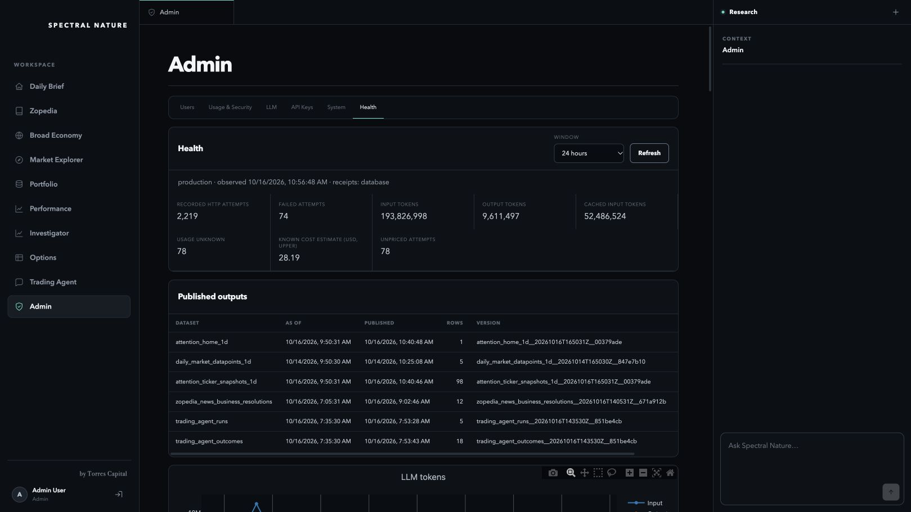

# Operational reliability promotion — October 16, 2026

**Source-preservation acceptance superseded.** The subsequent [release regression audit](../release-source-regressions-2026-10-16/README.md) confirmed eight affected areas, including Home, key/intraday charts, market-data safeguards, Zopedia maintenance, Robinhood refresh pacing and scheduled monitoring. The image/configuration checks below did not establish preservation of each consumer's accepted functionality. This remains a historical deployment record, not approval to reuse these images as an accepted application baseline.

[Why the repair did not restore overall service](../../research/system-reliability/PRODUCTION_FAILURES_2026-10-16.md) · [Master research index](../../research/README.md)

Status: **deployed; operational health remains degraded**. The owner explicitly authorized production promotion. Four production apps and sixteen job templates now use the accepted reliability release. The shared research engine revision remains `7281e3631a1764cf48c9`. The unaccepted LLM reasoning/cost candidate and hierarchical summarization defaults remain excluded.

[Immutable images, source hashes, configuration checks and remaining issues](release.json). [Development acceptance](../system-reliability-2026-10-16/README.md).

## Deployment and protected configuration

Both modern production frontends use the accepted dev web digest. The worker and broker templates use the accepted dev worker/broker digests. Two API-only Health collector updates were subsequently built with source guards, tested locally and in development, then promoted as identical immutable images to the two production APIs. The update does not change research-engine code or model settings.

All twenty production targets passed image, complete-template, configuration and identity checks. Production schedules, allocations, commands, credentials, namespaces, existing identity selectors and inference settings remain intact. Only the next API adds its dedicated production-only telemetry identity and two telemetry variables. That identity has resource-group Reader access. Two dev API images also changed for the verified Health correction; all other development resources remain unchanged.

A database-level execution protection was added separately: role `snadmin` in database `pipeline` now defaults to a 120-second statement timeout. A fresh connection reported `2min`. Explicit application settings retain their own scoped deadlines. The previous database-role setting was absent; exact rollback is `ALTER ROLE "snadmin" IN DATABASE "pipeline" RESET statement_timeout`. No database tier, container allocation or model upgrade was made.

## Live verification and incident findings

- Application revisions became ready; public frontend and legacy API health endpoints returned HTTP 200. Anonymous Admin Health returned HTTP 401. The existing owner session accessed production Health through the production Azure frontend alias. The custom-domain public Home endpoint returned HTTP 200 before promotion and again after initial database recovery, but its final check returned HTTP 503. Home is not reliably available under the ongoing load.
- Before this release, the pipeline database was near 100% CPU and old scheduled health executions were failing on connection timeouts. Inspection found twelve stale client evidence-search reads and one parallel worker, aged roughly 25–159 minutes. Their exact backend/query identities were captured before cancellation. Two subsequently overdue legacy read connections were closed. Committed published artifacts were preserved. New uncapped clients inherit the role default; the release's shared connection owner also enforces its own application deadlines. These actions do not establish that saturation is fully resolved.
- The first production Health request exposed a real latency flaw: sequential SQL collection could consume the BFF timeout and hide independent Azure/Blob observations. Corrected the shared telemetry owner with a 20-second response budget, bounded/coalesced in-flight collections and one physical connection for its contiguous SQL phase. Eight focused authorization/concurrency/failure checks passed. Against the real loaded database, the new collector returned six publication records, seventeen dev resources and four Azure metric series in 20.001 seconds, explicitly marking SQL collection pending. Actual dev managed-identity/UI reads then returned database usage, publications and resource observations before production promotion. After promotion, the production owner session returned all six publication records, provider token/attempt totals and independently selected pipeline-server Azure metrics. A slow first collection marked attempts unavailable; a later collection completed them. The legacy Admin workspace error remains separate. No LLM calls or DDL are started by Health.
- The normal newly deployed scheduled health execution `system-health-29869530` repaired eighteen manifest indexes with zero reported indexing failures. It then exceeded its existing five-minute platform window while draining the provider receipt backlog. Its Azure state is Failed; a historical database Running row is not evidence of successful completion.
- The small production retained-data conversation `zthread_7b2f65be62ab4c36a477d3de` failed with `no_usable_answer`. It used `write_policy=none` and the expected engine revision. One planner transport succeeded; its original-source read then timed out, and final synthesis reached its deadline before HTTP transport (`not_sent`). That unsent operation is not an additional provider call. The failed attempt and earlier material remain retained; no QA learning/memory update was requested. This is a failed execution check, not acceptance of production reasoning quality.

The public Home/news/Trading artifacts were not replaced with synthetic QA content. Home, snapshots, news resolutions and Trading outputs retain their own observation/publication times; the separate chart selection still has an older published source date. The full Home/news/Trading workload was not manually repurchased for this promotion.

## Remaining work

Database load remains an active operational issue. Some legacy/in-progress callers still perform expensive retained-evidence reads and indexing. The heavy legacy Admin workspace request may time out independently of the bounded Health collector. Recovery backlog processing also needs an execution budget separate from core health observation, so repair work cannot consume the heartbeat's platform window. Retain pending receipts and completed publications across batches; no additional paid service or rigid research-quality gate is needed.

The release is promoted, but the failed research check and scheduled monitoring execution prevent a fully healthy certification. Do not substitute ready revisions, completed schema checks or partial recovery for those outcomes.

## Summarization experiment explanation

The prototype supplied source summaries and an overview with navigable retained originals. The final 38 answers comprise fourteen full-source controls, fourteen basic hierarchy answers, four guidance variants and six catalog-first variants. All completed, but repeated omissions changed useful analysis: manufacturer operating profit/ cash-flow calculations were lost, database-tier restrictions were missed, and paper counterexamples were smoothed into a broad claim. Some arithmetic/reasoning errors also appeared in the full-source controls. These trials used cheap Flash with thinking and review cycles disabled; they do not establish that all hierarchical designs fail or that the normal configured research flow behaves identically.

The $0.37509 known estimated cost covers the entire investigation, including earlier exploratory/protocol-correction work: 315 distinct provider attempts, 314 successes and one unfinished/unpriced attempt. The 38-answer final batch cost $0.13429; retained summary construction cost $0.00874. An interrupted request lacked a usage receipt, so its charge remains unknown. This is experimental spend, not a production per-answer price or a verified whole-workload saving.

Keep summaries optional and cached over retained originals. The next experiment should test whether analysis actually revises important calculations, restrictions and counterexamples after original reads. Mandatory depth, forced reads, source quotas and premium model upgrades are not established solutions. [Complete experiment review](../../architecture/AQL/audits/HIERARCHICAL_SUMMARIZATION_EXPERIMENTS_2026-10-15.md).

Private operator evidence and rollback snapshots: `/tmp/sn-reliability-prod-20261016/`.

